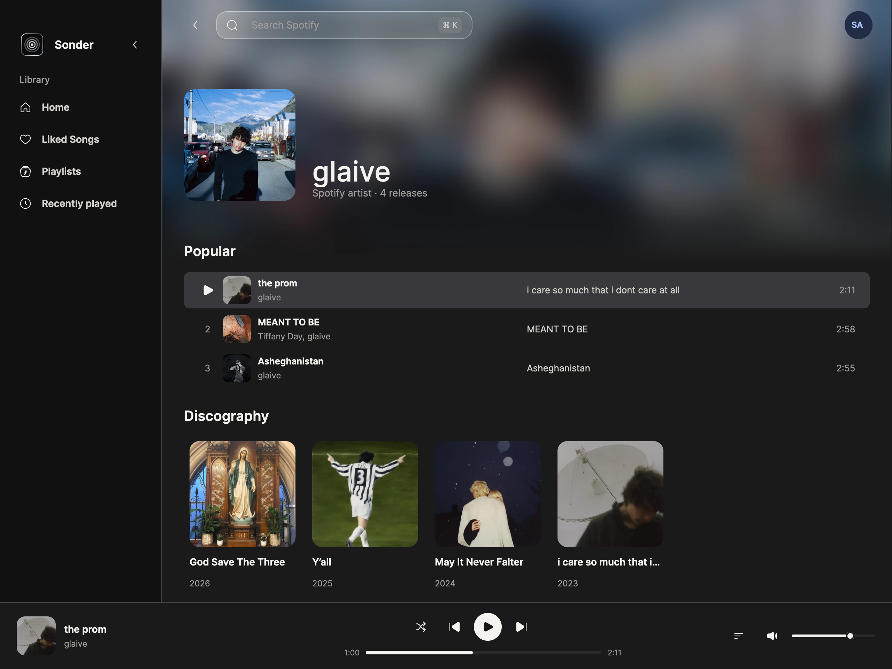
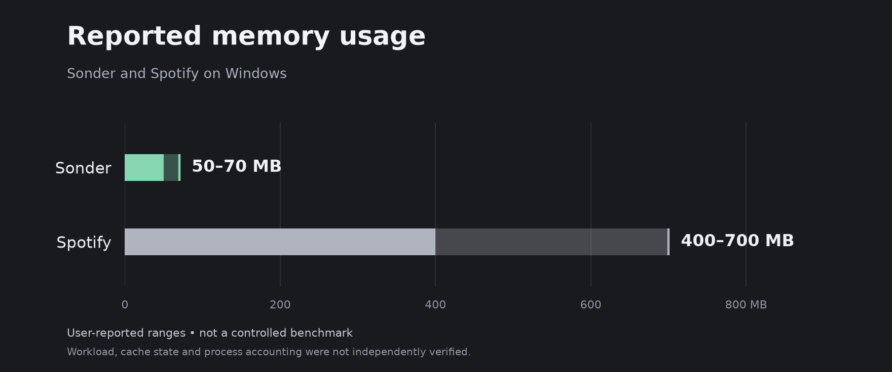

<p align="center">
  
</p>

<h1 align="center">Sonder</h1>

<p align="center">
  A minimal Spotify player for macOS and Windows.<br>
  Rust, GPUI rendering, and native audio playback.
</p>

<p align="center">
  <a href="LICENSE"></a>
</p>



Artist-page preview using public [glaive](https://open.spotify.com/artist/4cJKDGSv4Dz9QycXYmo565) metadata and artwork from Spotify.

This is an open-source Windows-focused fork of
[infomiho/cadence](https://github.com/infomiho/cadence). The original MIT license
and author attribution are preserved. macOS source support remains available.

## Windows downloads and updates

Download the optimized Windows x86-64 [Sonder.exe](https://github.com/parentless/sonder/releases/latest/download/Sonder.exe)
from [Releases](https://github.com/parentless/sonder/releases/latest). It is a release build with thin LTO, an embedded C runtime,
assets and precompiled GPUI shaders. The target computer needs no Rust toolchain
or Spotify desktop app. Spotify Premium and your own Spotify developer Client
ID are required; the app guides you through setup.

Windows release builds check this repository's public GitHub releases in the
background after launch and once daily. **Settings → Updates → Install update**
downloads and verifies the new executable, then restarts Sonder to replace it.
Automatic checks can be disabled. Keep Sonder in a writable directory such as
`%LOCALAPPDATA%\Programs\Sonder`. Debug builds do not self-update.

Every push to `main` builds an optimized `Sonder.exe` in Actions. Bumping `version`
in `Cargo.toml` and its `Cargo.lock` package entry publishes a new stable
`vMAJOR.MINOR.PATCH` release automatically after Windows checks pass. Re-pushing
the same version keeps its published release immutable and leaves fresh build
artifacts in the workflow run. Tag pushes and manual runs are supported too.
No Apple signing secrets, private access tokens, or separate update server are
needed. See [Windows setup](docs/WINDOWS.md) and [releasing](docs/RELEASING.md).

## Features

- Search artists, tracks, and playlists in one request, with artists shown above tracks
- Play music locally with queue, history, favorites, and radio
- Browse native artist and album pages
- Browse playlists in an expanded or compact icon sidebar, with tooltips, active-playlist selection, and recently opened playlists moving to the top
- Add tracks to the front of the upcoming queue without interrupting playback
- Clear artwork from Settings; the shared cache automatically removes older images at its memory budget
- See a brief red update indicator beside your account when a new release is available
- Jump through full playlist scrollbars; load visible 15-item pages after a 100 ms debounce and retain at most eight pages
- Remember recent album and playlist views, including scroll position; retain one inactive page of each kind with metadata limits alongside the eight-page playlist cache
- Shuffle loaded upcoming tracks without fetching whole playlists; explicitly queued tracks still play next
- Add or remove Spotify Liked Songs through the shared right-click menu; existing users sign out and back in once to grant library-edit permission
- Bundled Inter fonts provide the same family and weights on Windows and macOS
- Double-click tracks to play; right-click for the same actions across every track list
- Choose Graphite, Blue, Green, Purple, or Rose selection fills in Settings
- Scale the UI from 75% to 125% with saved zoom presets
- Use current-track play/pause controls directly in any track list
- Now Playing and media key controls
- Optional Discord Rich Presence with current track, artist, artwork, and progress
- Light, dark, and system appearances
- Persistent playback and library state

## Reported memory use



These are user-reported example ranges, not an independent benchmark. Actual
usage depends on workload, cache state, and process accounting. See
[the source values, limits, and comparison method](docs/PERFORMANCE.md).

## Built With

**Rust** + **GPUI** + **librespot** + **rspotify** + **SQLite** + **CPAL**

GPUI renders the native GPU-accelerated interface, librespot handles playback
through CPAL, rspotify connects to the Spotify Web API, and SQLite keeps local state.

## Install

For Windows, see [Windows build and installation instructions](docs/WINDOWS.md).
The **Windows** Actions workflow produces a portable `Sonder.exe`;
this fork preserves the Rust, GPUI, librespot, and CPAL architecture.

### macOS

1. Download the latest DMG from [Releases](https://github.com/infomiho/cadence/releases/latest).
2. Open the DMG and drag Sonder into Applications.
3. Launch Sonder from Applications and follow the Spotify setup below.

Release downloads are signed with Developer ID and notarized by Apple.

## Set Up Spotify

Sonder requires Spotify Premium. On first launch, Sonder guides you
through creating a Spotify developer app and entering its Client ID. Client IDs
are public; Sonder never needs your client secret.

1. Create an app in the [Spotify Developer Dashboard](https://developer.spotify.com/dashboard).
2. Add `http://127.0.0.1:8888/callback` as a redirect URI.
3. Copy the Client ID from **Basic Information** and enter it in Sonder.

Sonder stores the Client ID in app preferences and keeps login and playback
tokens in macOS Keychain or Windows Credential Manager.

## Run From Source

On Windows, follow the [MSVC and Windows SDK build instructions](docs/WINDOWS.md).
On macOS, building Sonder requires Rust and Apple's Metal Toolchain. Developers can skip
the setup screen by setting `SPOTIFY_CLIENT_ID` at launch:

```sh
SPOTIFY_CLIENT_ID="your-client-id" cargo run
```

For a stable local signature and fewer Keychain prompts during development:

```sh
SPOTIFY_CLIENT_ID="your-client-id" ./scripts/run-signed.sh
```

## Releases

Windows releases are built and published by this fork's Actions workflow.
See [releasing](docs/RELEASING.md) for the complete versioning and update flow.
The macOS signing scripts remain in source for maintainers who configure their
own Apple signing and Sparkle feed; this fork's publisher produces Windows assets.

Release builds do not include a shared Spotify Client ID. Each person configures
their own Spotify developer app on first launch. Logo and bundled backend
attributions are in [THIRD_PARTY_NOTICES.md](THIRD_PARTY_NOTICES.md).

## License

[MIT](LICENSE)
